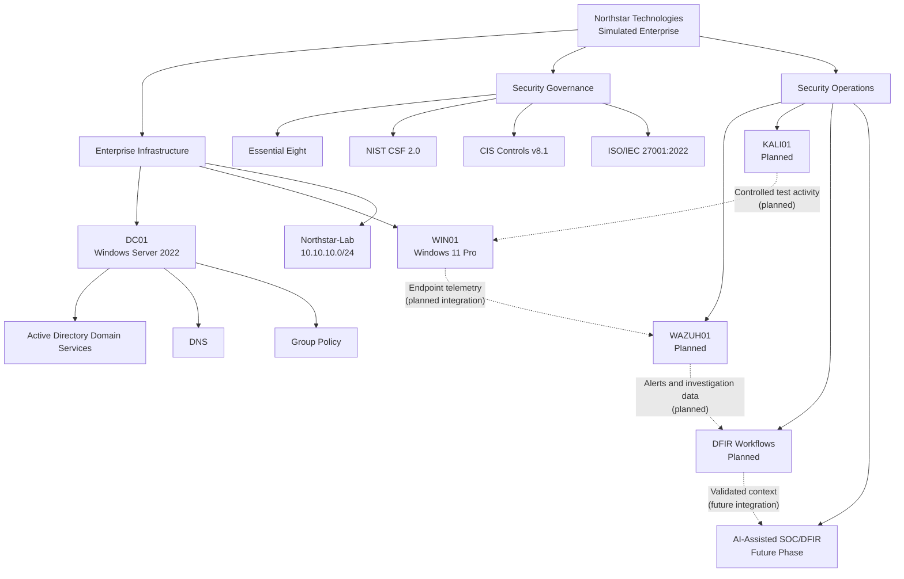
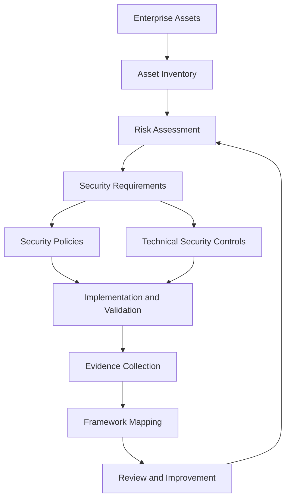
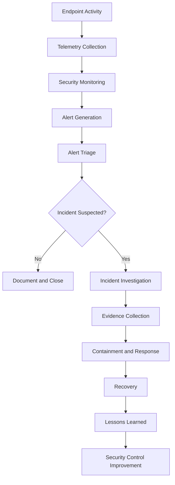

# Northstar Technologies — Enterprise Security Architecture

## 1. Purpose

This document describes the logical enterprise architecture of the Northstar Technologies Enterprise Security & DFIR Lab.

It identifies the main infrastructure components, their responsibilities, security relationships and intended operational workflows.

The architecture represents a simulated enterprise environment built using Oracle VirtualBox.

## 2. High-Level Architecture

The environment is organised into five major areas:

1. Enterprise infrastructure.
2. Identity and endpoint management.
3. Security controls and governance.
4. Security monitoring and incident response.
5. AI-assisted security operations.

### Logical Architecture

**Diagram interpretation:** DC01 and WIN01 represent the configured enterprise foundation. The dotted connections represent intended future integrations, not confirmed operational data flows.

## 3. Enterprise Infrastructure

### 3.1 DC01 — Domain Controller

| Attribute | Configuration |
|---|---|
| Hostname | DC01 |
| Operating system | Windows Server 2022 Standard Evaluation |
| IPv4 address | `10.10.10.10` |
| Domain | `northstar.local` |
| Roles | Active Directory Domain Services and DNS |
| Status | Configured; further service verification should be evidenced |

Responsibilities:

- Centralised identity management.
- Domain authentication.
- Directory services.
- DNS for the Active Directory environment.
- Group Policy management.

### 3.2 WIN01 — Employee Workstation

| Attribute | Configuration |
|---|---|
| Hostname | WIN01 |
| Operating system | Windows 11 Pro |
| IPv4 address | `10.10.10.20` |
| DNS server | `10.10.10.10` |
| Domain | `northstar.local` |
| Status | Installed, configured and domain join verified |

Responsibilities:

- Represents an employee endpoint.
- Participates in the Active Directory domain.
- Receives centrally managed policies.
- Acts as an endpoint for future security telemetry collection.
- Provides a target for controlled security testing.

### 3.3 WAZUH01 — Security Monitoring Server

**Status: Planned**

WAZUH01 will host the Wazuh security monitoring platform.

Intended responsibilities:

- Centralised endpoint telemetry collection.
- Security event analysis.
- File integrity monitoring.
- Security configuration assessment.
- Vulnerability detection capabilities supported by the deployment.
- Alert generation and investigation.

The final operating system, IP address and deployment architecture will be documented after implementation.

### 3.4 KALI01 — Controlled Testing System

**Status: Planned**

KALI01 will be used to generate controlled security testing activity within the isolated lab.

Intended purposes:

- Network reconnaissance.
- Controlled attack simulation.
- Security control validation.
- Detection testing.
- Generating investigation scenarios.

All testing will remain within the authorised lab environment.

### 3.5 WIN02 — Additional Endpoint

**Status: Optional; not started**

WIN02 may be introduced later to represent an additional employee workstation and provide a broader endpoint environment for security monitoring and policy testing.

## 4. Network Architecture

The virtual machines are intended to communicate through the VirtualBox Internal Network:

`Northstar-Lab`

Network addressing:

| Component | IPv4 address |
|---|---|
| Network | `10.10.10.0/24` |
| DC01 | `10.10.10.10` |
| WIN01 | `10.10.10.20` |
| WAZUH01 | To be assigned |
| KALI01 | To be assigned |
| WIN02 | To be assigned if deployed |

DC01 provides DNS for the domain environment.

WIN01 uses DC01 as its DNS server.

No IP address or connectivity status is assigned to the planned systems until they are deployed and verified.

## 5. Security Governance and Control Architecture

The enterprise architecture uses four complementary security references.

| Framework | Role in the project |
|---|---|
| Essential Eight | Prioritised mitigation strategies |
| NIST CSF 2.0 | Organises cybersecurity outcomes and activities |
| CIS Controls v8.1 | Technical safeguards and implementation guidance |
| ISO/IEC 27001:2022 | ISMS, risk management and governance reference |

The intended governance and control process is:

Security controls should be selected based on identified risks and validated through observable configuration and test evidence.

## 6. Security Operations Architecture

The planned security operations process follows this sequence:

This is the intended workflow. Its operational implementation depends on the deployment and validation of the monitoring and DFIR components.

## 7. DFIR Architecture

The Digital Forensics and Incident Response component will provide a structured process for investigating security incidents.

Planned capabilities include:

- Event timeline reconstruction.
- Windows event log analysis.
- Endpoint artefact examination.
- Suspicious process investigation.
- Persistence mechanism analysis.
- Evidence collection and preservation.
- Incident documentation.
- Findings and recommendations.

The investigation process should maintain evidence integrity and document relevant timestamps, collection methods and analysis steps.

## 8. AI-Assisted SOC and DFIR Architecture

AI capabilities will be introduced after the core enterprise infrastructure, monitoring and DFIR workflows are operational.

Potential integration points:

| Integration point | Intended capability |
|---|---|
| Alert triage | Summarise alerts and prioritise investigation |
| Event analysis | Explain relevant event sequences |
| Threat intelligence | Enrich investigations with contextual information |
| Incident investigation | Assist with hypothesis development |
| DFIR reporting | Help structure investigation findings |
| Security operations | Support analyst workflows |

AI outputs must not be treated as authoritative evidence. Analysts must validate findings against original logs, artefacts and other reliable sources.

## 9. Architecture Dependencies

The intended implementation sequence is:

1. Establish and verify the domain infrastructure.
2. Configure and validate the domain-joined workstation.
3. Implement and verify workstation security policies.
4. Deploy Wazuh.
5. Integrate supported endpoint telemetry.
6. Deploy Kali Linux for controlled testing.
7. Validate security detection and alert investigation.
8. Develop repeatable DFIR workflows.
9. Introduce AI-assisted SOC/DFIR capabilities.

## 10. Architecture Status

| Component | Status |
|---|---|
| VirtualBox environment | Established |
| Northstar-Lab network | Configured |
| DC01 | Configured |
| Active Directory and DNS | Configured |
| northstar.local domain | Created |
| WIN01 | Configured and domain joined |
| Workstation baseline GPO | Created and linked; effective firewall settings under investigation |
| WAZUH01 | Planned |
| KALI01 | Planned |
| DFIR workflows | Planned |
| AI-assisted SOC/DFIR | Future phase |

## 11. Design Limitations

- This architecture is a lab design, not a production deployment.
- Planned components are not represented as operational services.
- Network connectivity between future components must be verified after deployment.
- Framework mappings do not establish certification or complete compliance.
- AI-assisted findings require human validation.
