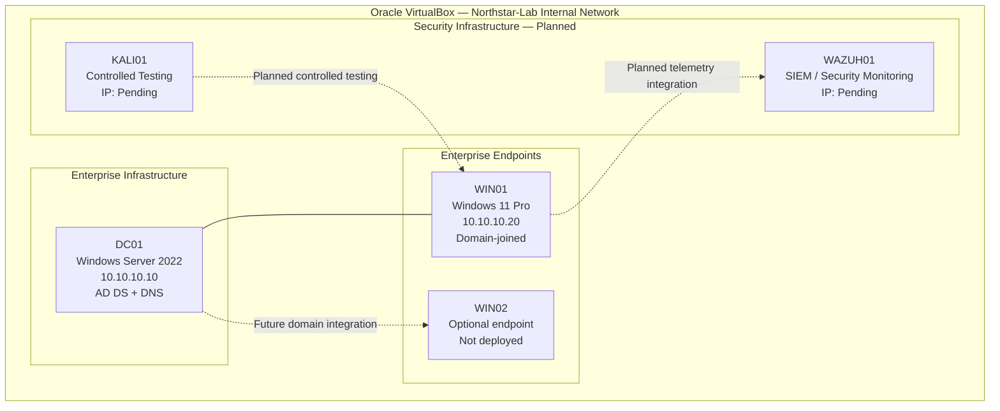

# Northstar Technologies — Network Architecture

## 1. Network Overview

The Northstar Technologies Enterprise Security & DFIR Lab uses an isolated VirtualBox Internal Network to connect the simulated enterprise systems.

| Network parameter | Value |
|---|---|
| Virtualisation platform | Oracle VirtualBox |
| Network type | Internal Network |
| Network name | `Northstar-Lab` |
| Network address | `10.10.10.0/24` |
| Subnet mask | `255.255.255.0` |
| Active Directory domain | `northstar.local` |
| Default gateway | Not configured in the current addressing plan |

## 2. Logical Network Diagram



**Diagram notation:**

- Solid connection: configured relationship represented in the current lab design.
- Dotted connection: planned relationship, not yet verified or operational.
- Pending IP: no address assigned in the current implementation record.

## 3. IP Addressing Plan

| Host | Role | IPv4 address | DNS | Status |
|---|---|---|---|---|
| DC01 | Domain Controller and DNS | `10.10.10.10` | `10.10.10.10` | Configured |
| WIN01 | Domain-joined workstation | `10.10.10.20` | `10.10.10.10` | Configured and verified |
| WAZUH01 | SIEM | Pending | Pending | Planned |
| KALI01 | Testing system | Pending | Pending | Planned |
| WIN02 | Additional workstation | Pending | Pending | Optional; not started |

## 4. Network Responsibilities

### DC01

- Provides Active Directory Domain Services.
- Provides DNS for the domain environment.
- Manages domain identities and computer accounts.
- Hosts Group Policy management.

### WIN01

- Represents an enterprise employee workstation.
- Uses DC01 for DNS.
- Is joined to `northstar.local`.
- Is the initial endpoint for future security monitoring integration.

### WAZUH01

Planned responsibilities:

- Collect endpoint telemetry.
- Analyse supported security events.
- Generate security alerts.
- Support security monitoring and investigation.

### KALI01

Planned responsibilities:

- Generate controlled test traffic.
- Simulate selected attacker techniques.
- Validate detection and security controls.

## 5. Network Security Considerations

The following controls are relevant to the isolated lab:

- Keep the VirtualBox Internal Network separate from external networks.
- Avoid exposing domain services unnecessarily.
- Restrict administrative access.
- Apply host and endpoint firewall policies.
- Use controlled and documented attack simulations.
- Avoid using real production credentials or sensitive information.
- Validate network connectivity after every new VM is introduced.

## 6. Network Verification

The following checks should be performed and retained as evidence.

### On DC01

Display network configuration:

```powershell
ipconfig /all
```

Check DNS resolution:

```powershell
nslookup northstar.local
```

### On WIN01

Display network configuration:

```powershell
ipconfig /all
```

Test connectivity to DC01:

```powershell
ping 10.10.10.10
```

Check domain DNS resolution:

```powershell
nslookup northstar.local
```

Check the domain controller's LDAP service record:

```powershell
nslookup -type=SRV _ldap._tcp.dc._msdcs.northstar.local
```

A successful ping alone does not establish that Active Directory, DNS or Group Policy is functioning correctly. Each service must be validated independently.

## 7. Future Network Expansion

When WAZUH01 and KALI01 are deployed:

1. Assign static IP addresses within the lab subnet.
2. Configure the correct VirtualBox Internal Network attachment.
3. Verify that the intended systems can communicate.
4. Confirm DNS settings where required.
5. Configure only the required firewall rules.
6. Test telemetry ingestion and controlled attack activity.
7. Update this diagram to reflect verified connectivity.

## 8. Implementation Status

The current configured enterprise network foundation consists of DC01 and WIN01.

WAZUH01, KALI01 and WIN02 are not included as operational systems in the current network. Their IP addresses and connections will be documented after deployment and verification.
